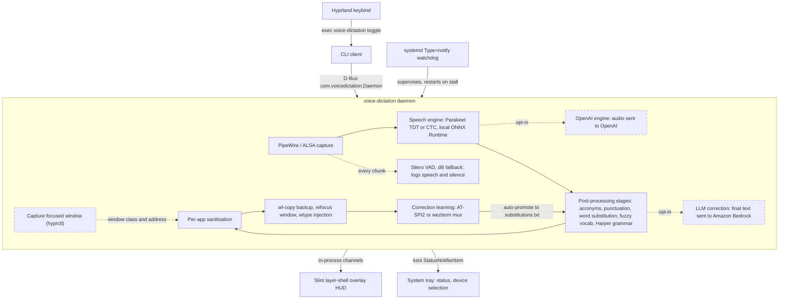

# Wayland Voice Dictation

Voice dictation for Wayland desktops. Speech recognition runs locally with NVIDIA Parakeet by default. Press a key to start recording, press again to transcribe and type the result into the focused window.

## Features

- **Local by default.** The default engine runs on your machine. Hosted engines and the LLM stage are opt-in (see [Privacy](#privacy)).
- **NVIDIA Parakeet TDT 0.6b.** English speech recognition through ONNX Runtime, with a live preview while you speak. CTC model variants are also supported.
- **Opt-in OpenAI engines.** `openai:<model>` sends audio to OpenAI, using `OPENAI_API_KEY`.
- **Post-processing stages.** Acronyms, punctuation and casing, word substitution, fuzzy vocabulary matching, Harper grammar, and an optional LLM correction pass.
- **Per-app behaviour.** Terminals get shell-safe escaping and per-word typing. The target window is refocused before typing (Hyprland).
- **Correction learning.** Watches your edits after dictation through AT-SPI2, or through the wezterm mux for wezterm. Repeated fixes become word substitutions.
- **Voice activity detection.** Silero VAD (with a dB-threshold fallback) classifies each session's audio and logs speech and silence durations.
- **Slint overlay.** Transparent HUD showing recording state and live transcription.
- **System tray.** Status icon with device selection and quick controls.
- **D-Bus control.** A clean interface for keybind integration.
- **systemd daemon.** Persistent background service with watchdog support.
- **playerctl integration.** Pauses media while recording and resumes it after.

## How it works

With the default engine the pipeline runs on-device inside one daemon. The dashed boxes are opt-in or Hyprland-only.



The VAD runs on every captured chunk in each session. It does not trim or cut the audio: the engine receives the full recording, pauses included.

## Privacy

- **Default:** audio and text stay on your machine. Parakeet transcribes locally, and every default post-processing stage is local.
- **Opt-in hosted engine:** setting `model = "openai:<model>"` sends your audio to OpenAI, plus your user-dictionary words as keyword hints.
- **Opt-in LLM stage:** adding `llm_correction` to a `[pipeline]` list sends the final text to Amazon Bedrock.
- **Model downloads:** `voice-dictation download-model` fetches Parakeet from HuggingFace. On first start, the daemon downloads the Silero VAD model from GitHub to `~/.local/share/voice-dictation/models/` (disable with `vad_enabled = false`).

## Requirements

- Wayland compositor (Hyprland, Sway, etc.)
- `wtype`: keyboard input injection
- PipeWire or ALSA audio
- ~1.6 GB disk space for the Parakeet model

Optional:

- `playerctl`: media pause and resume
- `wl-clipboard` (`wl-copy`): the final text is copied to the clipboard before typing, as a backup
- Hyprland (`hyprctl`): window refocus and terminal detection
- `gsettings` and AT-SPI2: correction learning in GTK and Qt apps
- `wezterm`: correction learning inside wezterm

## Installation

### Arch Linux

Add the [mason](https://github.com/MasonRhodesDev/arch-repo) pacman repository to `/etc/pacman.conf`:

```ini
[mason]
# Import the signing key first: https://github.com/MasonRhodesDev/arch-repo#use-it
SigLevel = Required DatabaseRequired
Server = https://masonrhodesdev.github.io/arch-repo/x86_64
```

Then install:

```bash
sudo pacman -Sy wayland-voice-dictation
```

### Fedora

```bash
sudo dnf copr enable solaris765/wayland-voice-dictation
sudo dnf install wayland-voice-dictation
```

Both packages install the binary to `/usr/bin/voice-dictation`, the systemd
user unit, and the standalone model download script under
`/usr/share/wayland-voice-dictation/`.

### From source (development)

```bash
git clone https://github.com/MasonRhodesDev/wayland-voice-dictation
cd wayland-voice-dictation

make install
```

`make install` builds the release binary, installs it to `~/.local/bin/voice-dictation`,
installs and reloads the systemd user service, restarts the daemon so it runs the binary
you just built, and removes any stale shadow copy (see warning below). Override the
locations if you need to:

```bash
make install BINDIR=/usr/local/bin UNITDIR=/etc/systemd/user
```

To remove everything (your model and config under `~/.config/voice-dictation` are kept):

```bash
make uninstall
```

> **Do not `cargo install --path .`** — that installs to `~/.cargo/bin`, which usually
> precedes `~/.local/bin` on `PATH`. The keybind would then run the `~/.cargo/bin` copy
> while the systemd daemon runs the `~/.local/bin` copy, and a stale shadow there makes
> the keybind silently misbehave. Use `make install`, which keeps a single binary in
> `~/.local/bin`. Run `make doctor` any time the keybind seems dead — it reports
> duplicate binaries on `PATH`.
> The packaged installs above are immune to this: they own the single copy in
> `/usr/bin`. Don't mix a dev install with a packaged one.

Cargo features `pipewire`, `tray` and `correction` are on by default. Build with
`--no-default-features` to drop the PipeWire backend, the tray, or AT-SPI2 correction learning.

## Download the Model

The Parakeet model (~1.6 GB) is not included and must be downloaded separately:

```bash
voice-dictation download-model
```

This downloads the model from HuggingFace to `~/.config/voice-dictation/models/parakeet/`. Files already present are skipped.

Alternatively, use the standalone shell script (requires `curl`):

```bash
bash scripts/download-parakeet-model.sh
# or, from a packaged install:
bash /usr/share/wayland-voice-dictation/download-parakeet-model.sh
```

Both download the TDT model only. The CTC variants (see [Engines](#engines)) read
`~/.config/voice-dictation/models/parakeet-ctc/`, which you populate yourself.

## Setup

### Start the daemon

```bash
# Enable on login
systemctl --user enable --now voice-dictation

# Check status
systemctl --user status voice-dictation
journalctl --user -u voice-dictation -f
```

### Hyprland keybind

Add to `~/.config/hypr/hyprland.conf`:

```
bind = SUPER, V, exec, voice-dictation toggle
```

Press `Super+V` to start recording. Press again to confirm and type the transcription.

> If the keybind seems to do nothing, run `make doctor` and `voice-dictation diagnose`.
> The most common causes are a duplicate binary on `PATH` (the bind runs a different one
> than the daemon) or a wedged daemon — `systemctl --user restart voice-dictation` clears
> the latter.

### Other compositors

Any Wayland compositor supporting `wtype` works. Map `voice-dictation toggle` to a key using your compositor's keybind system.

Window capture uses `hyprctl`, so on other compositors the daemon cannot refocus the original window before typing, and it cannot tell terminals apart: every target gets the general profile (see [Per-app behaviour](#per-app-behaviour)).

## CLI Usage

```
voice-dictation <COMMAND>

Session:
  daemon                     Start the dictation engine daemon
  start                      Start a recording session
  stop                       Cancel recording
  confirm                    Finalize and type the transcription
  toggle                     Start if idle, confirm if recording
  status                     Show daemon and subsystem status

Setup and inspection:
  config                     Open the configuration TUI
  download-model             Download the Parakeet TDT model from HuggingFace
  list-models                List model specs
  list-preview-models [LANG] Same list (kept for compatibility)
  list-final-models [LANG]   Same list (kept for compatibility)
  list-audio-devices         List available audio input devices
  diagnose                   Show diagnostics (audio, config, models, VAD)
  transcribe-file WAV        Run a WAV through an engine and its stages (--model, --stages, --paced)
  test-loop [--recording F]  Open the test loop UI for iterative transcription tuning

Vocabulary:
  dict add|remove WORD       Manage the user dictionary (words exempt from spell checking)
  dict list
  subst add SPOKEN REPL      Manage word substitutions (spoken phrase -> replacement)
  subst remove SPOKEN
  subst list

Correction learning:
  corrections list           List learned corrections and blocklisted pairs
  corrections remove PHRASE  Remove corrections by original phrase and blocklist them
  corrections clear          Remove all learned corrections (the blocklist is kept)
  corrections edit           Open corrections.json in $EDITOR
  correction-stats           Show correction learning statistics
  snapshot-correction        Re-arm correction monitoring for the last dictation

Debug:
  debug list                 List saved debug recordings (VOICE_DICTATION_DEBUG_AUDIO=1)
  debug play FILE            Play a debug recording
  debug wezterm-probe        Probe the wezterm mux used by the wezterm correction backend
  debug ime-probe            Time-boxed zwp_input_method_v2 diagnostic (--secs, --json, --commit, --commit-class)
```

`dict` and `subst` edit `~/.local/share/voice-dictation/user_words.txt` and
`substitutions.txt` directly; the running daemon hot-reloads both files.

`debug ime-probe` binds `zwp_input_method_v2` for a fixed time (30 s by default) and logs
every IME event, tagged with the focused window class. It never grabs the keyboard and exits
if another input method holds the slot. `--commit TEXT` sends text into the focused editor,
but only while a window whose class exactly matches `--commit-class` is focused. The results
from running it against GTK, Chromium, Discord and wezterm are in
[docs/ime-backend-findings.md](docs/ime-backend-findings.md).

## Configuration

Run `voice-dictation config` to open the interactive configuration TUI, which covers all daemon settings:


Config file: `~/.config/voice-dictation/config.toml`. Daemon settings live in `[daemon]`.
`audio_device` and `sample_rate` are required: if either is missing, or the file does not
parse, the daemon logs a warning and uses the defaults for everything.

```toml
[daemon]
audio_device = "default"
sample_rate = "16000"
audio_backend = "auto"          # "auto", "cpal" (ALSA) or "pipewire"
model = "parakeet:default"

# Post-processing switches (see "Post-processing stages")
enable_acronyms = true
enable_punctuation = true
enable_word_substitution = true
enable_fuzzy_vocab = true
enable_grammar = true

# Voice activity detection
vad_enabled = true              # Silero when it loads, else the dB threshold below
vad_threshold = 0.5             # Silero speech probability (0.0-1.0)
silence_threshold_db = -60.0    # dB fallback VAD only; capture never drops quiet audio
```

Run `voice-dictation diagnose` to inspect the current configuration, model status, and which VAD actually loads.

### Engines

Set `model` in `[daemon]` to choose one engine:

| Model | Runs | Live preview | Needs |
|---|---|---|---|
| `parakeet:default` | Locally, TDT model | Yes | `models/parakeet/` (from `download-model`) |
| `parakeet:ctc-<name>` (e.g. `ctc-1.1b`) | Locally, CTC model through parakeet-rs, greedy decoding | Yes | `models/parakeet-ctc/` |
| `parakeet:ctc-direct` | Locally, CTC model through ONNX Runtime with beam search and hotword boosting | Yes | `models/parakeet-ctc/` (`model.onnx`, `tokenizer.json`) |
| `openai:gpt-live-transcribe` | OpenAI realtime WebSocket | Yes | `OPENAI_API_KEY` |
| `openai:<model>` (e.g. `gpt-transcribe`) | OpenAI, one upload when you stop | No | `OPENAI_API_KEY` |

Model directories are under `~/.config/voice-dictation/models/`. `ctc-direct` boosts the
words listed in `~/.local/share/voice-dictation/hotwords.txt`.

An `openai:` model whose name starts with `gpt-live-transcribe` or contains `realtime` uses the
realtime engine; any other name uses the batch engine. If the realtime stream fails, the
realtime engine transcribes the recorded audio once with `gpt-transcribe`, so the utterance is
not lost. The OpenAI engines send your user-dictionary words as keyword hints. The `[openai]`
section sets the prompt, extra keywords, languages and the realtime delay.

The daemon reads `OPENAI_API_KEY` from its own environment. Under systemd, set it in a drop-in
(`systemctl --user edit voice-dictation`, then `Environment=OPENAI_API_KEY=...`). Without the
key the OpenAI engine cannot be built.

### Post-processing stages

Text helpers are named stages:

| Stage | What it does |
|---|---|
| `acronyms` | Joins spelled-out letters: "a p i" becomes "API" |
| `punctuation` | Sentence casing and the pronoun "I" |
| `word_substitution` | Exact spoken-phrase rewrites from `substitutions.txt` |
| `fuzzy_vocab` | Snaps near-misses onto user-dictionary words ("hyperland" to "hyprland") |
| `grammar` | Harper grammar and spell checking |
| `llm_correction` | LLM rewrite of the final text (opt-in, see below) |

Each engine declares the stages it needs. Parakeet declares the first five. The OpenAI engines declare none, because their output is already punctuated and uses keyword hints for vocabulary.

The `[pipeline]` section overrides the declaration per engine. `default` keeps the declaration and `none` runs no stages. The `enable_*` switches in `[daemon]` still turn a stage off for every engine.

```toml
[pipeline]
parakeet = "acronyms,punctuation,word_substitution,fuzzy_vocab"   # local, without Harper
openai = "default"                                                # nothing
```

`grammar` and `llm_correction` run on the final text only, never on the live preview.

After the stages, the text is sanitised for the target app (see [Per-app behaviour](#per-app-behaviour)).

To compare engines or stage lists on one recording, convert it to 16 kHz mono and run:

```bash
voice-dictation transcribe-file clip.wav --model parakeet:default --stages none --paced
```

### LLM correction

The `llm_correction` stage sends the final text to a model on Amazon Bedrock. It applies spoken self-corrections such as "scratch that" and fixes glossary terms. Add it to a `[pipeline]` list and set the model:

```toml
[llm_correction]
model = "arn:aws:bedrock:us-west-2:123456789012:application-inference-profile/abc123"
region = "us-west-2"
aws_profile = "my-sso-profile"   # read with `aws configure export-credentials`
timeout_ms = 3000
```

On a timeout, an expired credential, or a reply that is not an edit of the input, the stage keeps the original text and logs a warning.

### Per-app behaviour

When recording starts, the daemon records the focused window's class and address with
`hyprctl activewindow`. When you confirm, it:

1. Picks a profile from the window class. `kitty`, `Alacritty`, `foot`,
   `org.wezfurlong.wezterm`, `com.mitchellh.ghostty`, `ghostty` and `tmux` are terminals;
   everything else is general.
2. Sanitises the text. Every profile strips ANSI escape sequences and control characters.
   Terminals also escape `$`, `` ` ``, `\` and `!` so the shell does not expand them.
3. Copies the text to the clipboard with `wl-copy`, so it survives an interrupted typing run.
4. Refocuses the original window, in case you switched windows while speaking.
5. Types with `wtype`: all at once for general apps, or word by word with a 50 ms delay in
   terminals, so terminal UIs keep up.

Window capture and refocus are Hyprland-only. Without `hyprctl`, steps 1 and 4 are skipped
and every target gets the general profile.

### Correction learning

After typing, the daemon watches the target for edits you make to the injected text. It
records each original-to-corrected pair in `~/.local/share/voice-dictation/corrections.json`.
When the same correction reaches the auto-promote threshold, it is appended to
`substitutions.txt` and applied to later dictations by the `word_substitution` stage.

There are two backends:

- **AT-SPI2** for apps that emit accessibility text events. GTK apps only load the
  accessibility bridge when `org.gnome.desktop.interface toolkit-accessibility` is on, so the
  daemon turns it on at startup through `gsettings`.
- **wezterm**, which AT-SPI2 cannot see. The daemon finds the live wezterm socket, snapshots
  the focused pane with `wezterm cli get-text`, and polls it for edits to the injected text.
  It never starts a mux server. TUIs that redraw the screen (nvim, fzf) are not tracked well.
  `voice-dictation debug wezterm-probe` checks this setup.

```toml
[daemon]
enable_correction_learning = true
correction_monitor_duration_secs = 60    # how long to watch after each dictation
correction_auto_promote_threshold = 3    # occurrences before promotion to substitutions.txt
correction_max_age_days = 30             # unpromoted corrections older than this are pruned at startup
enable_accessibility_bridge = true       # set toolkit-accessibility through gsettings
correction_backend_wezterm = true        # use the wezterm backend when the target is wezterm
```

Manage the store with `voice-dictation corrections list|remove|clear|edit`. A removed pair is
blocklisted, so it is never recorded or promoted again. `snapshot-correction` re-arms monitoring
for the last dictation, to catch edits made after the monitoring period ended.

## Troubleshooting

**Daemon not starting:**
```bash
journalctl --user -u voice-dictation -n 50
voice-dictation diagnose
```

**Model missing:**
```bash
voice-dictation download-model
```

**No audio input / wrong device:**
```bash
voice-dictation list-audio-devices
# Then set audio_device in config
voice-dictation config
```

**wtype not found:**
```bash
# Arch
sudo pacman -S wtype
# Fedora
sudo dnf install wtype
```

**OpenAI engine not used:** check that `OPENAI_API_KEY` is set in the daemon's environment
(`systemctl --user show voice-dictation -p Environment`), not only in your shell.

## Project Structure

```
src/
  main.rs                     CLI frontend and D-Bus client
  utils.rs                    Model and device listing helpers
dictation-engine/             Core library
  src/lib.rs                  Daemon entry point, config, and state machine
  src/model_selector.rs       Model spec parsing and engine construction
  src/stream_engine.rs        Streaming engine trait and local engine driver
  src/parakeet_engine.rs      Parakeet TDT engine
  src/ctc_engine.rs           Parakeet CTC engine (parakeet-rs)
  src/ctc_direct_engine.rs    CTC engine on ONNX Runtime with hotword beam search
  src/openai_engine.rs        OpenAI batch engine (opt-in)
  src/openai_realtime_engine.rs  OpenAI realtime engine (opt-in)
  src/audio_backend/          PipeWire and cpal (ALSA) capture
  src/vad.rs                  Silero and dB-threshold VAD
  src/post_processing/        Stages, sanitisation, and LLM correction
  src/app_profile.rs          Per-app typing delay and sanitisation
  src/window_target.rs        Focused-window capture and refocus (hyprctl)
  src/keyboard.rs             wtype injection
  src/ime_probe.rs            debug ime-probe
  src/tray.rs                 System tray
dictation-types/              Shared types
correction-engine/            Correction learning: AT-SPI2 and wezterm backends, store
slint-gui/                    Overlay HUD (Slint UI)
test-loop-ui/                 Test loop UI for re-running recordings (voice-dictation test-loop)
third_party/
  layer-shika-adapters/       Patched layer-shika-adapters crate (overlay mouse passthrough),
                              applied with [patch.crates-io]
docs/                         Audio, error handling, and IME backend notes
dist/
  voice-dictation.service     systemd user unit (packaged payload)
packaging/
  PKGBUILD                    Arch Linux package
  wayland-voice-dictation.spec  Fedora RPM spec (COPR)
  build-srpm.sh               SRPM builder (vendored cargo deps)
scripts/
  check-deps.sh               Dependency checker
  download-parakeet-model.sh  Standalone model downloader
  list-audio-devices.sh       List audio devices
config-schema.json            Config schema for the TUI
```

## License

Licensed under either of [MIT](LICENSE-MIT) or [Apache 2.0](LICENSE-APACHE) at your option.
